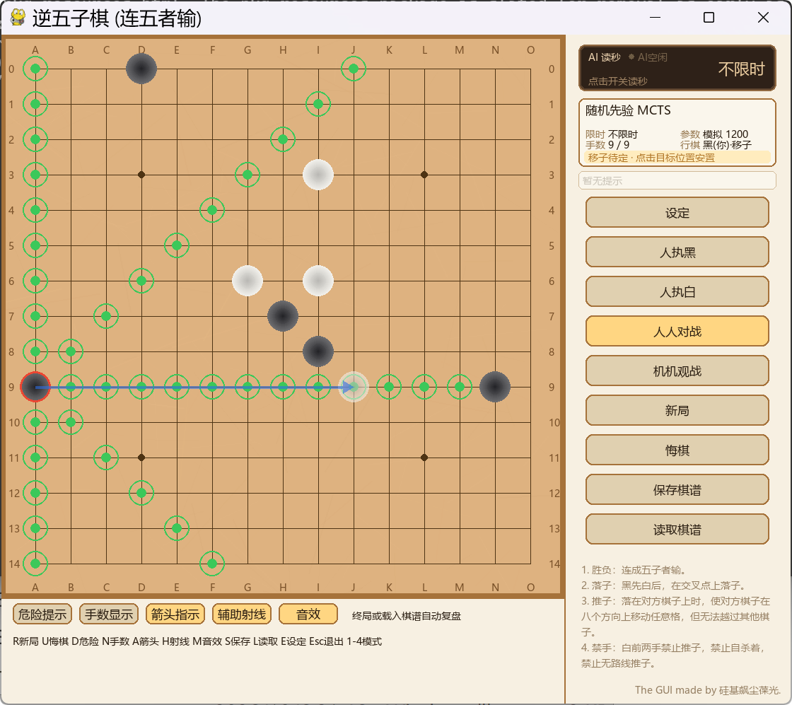

# 逆五子棋 Antifive —— AI 对战 GUI

[English](README_EN.md)



**English abstract.** Antifive is an open-source project for **Inverse Gomoku**
(Chinese: 逆五子棋; the player who first makes five in a row *loses*). It ships
a pygame GUI, a pure-numpy rules engine, a heuristic AI,
an AlphaZero-style policy/value network (training attempt **failed**, kept for
reproduction), and a KataGo integration with self-trained inverse-gomoku
weights. All code is MIT-licensed and heavily AI-generated.

> ## AI 使用声明
>
> **请注意**:本项目代码与文本主体由 AI 生成,经过人工初步核查但仍需要仔细甄别内容正误。
>
>> **AI Usage Statement:**
>>
>> **Please note** that the code and text content of this project are generated
>> by AI, preliminarily reviewed by humans, but still require careful
>> verification of accuracy.
>>

---

## 目录

- [项目简介](#项目简介)
- [在线网页版](#在线网页版)
- [逆五子棋与发明人](#逆五子棋与发明人)
- [项目状态(重要,先读)](#项目状态重要先读)
- [安装](#安装)
- [依赖自检与一键配置](#依赖自检与一键配置推荐)
- [快速开始](#快速开始)
- [界面与快捷键](#界面与快捷键)
- [AI 引擎与权重](#ai-引擎与权重)
  - [五档实现对照](#五档实现对照)
  - [两端 Elo](#两端-elo各自最低档--0)
  - [同 15s 墙钟对打](#同-15s-墙钟桌面端-vs-网页端)
- [棋谱格式](#棋谱格式)
- [训练(负结果)](#训练负结果)
- [仓库结构](#仓库结构)
- [环境与已知边界](#环境与已知边界)
- [更新日志](CHANGELOG.md)
- [第三方与致谢](#第三方与致谢)
- [License](#license)
- [找到我](#找到我)

---

## 项目简介

**逆五子棋**在 15×15 棋盘上进行,标准规则:

1. 胜负：先连成五子者输。
2. 落子：黑先白后，在交叉点上交替落子。
3. 推子：落在对方棋子上，然后在八个方向上移动该棋子任意格，但会被其他棋子阻挡。
4. 禁手：白前两手禁止推子(默认;GUI/网页「设定」可调禁推手数,0=无禁推)，禁止自杀着，禁止无路线推子。

> **名称说明**:本项目采用「逆五子棋」这一名称,以区别于**没有移子规则**的
> 反五子棋;两者胜负条件相同(连五者判负),但逆五子棋包含占领与安置的移子
> 机制。完整规则与动作编码见 [`docs/rules.md`](docs/rules.md)。

项目包含:

- **pygame 图形界面**:人机/人人/机机对战、复盘与试下分支、危险提示、移子箭头与
  辅助射线、落子二次确认(防误触)、人类认输、读秒、合成音效、`.afg` 棋谱保存/读取;
- **规则引擎**:纯 numpy(训练用批量 GPU 镜像在 `training/`);
- **AI 引擎**:随机先验 MCTS、自研策略价值网络 MCTS、启发式 AI(alpha-beta)、
  KataGo(逆五自训练权重);
- **训练代码**:AlphaZero 风格自对弈训练与对启发式的课程训练(总体失败,
  负结果保留);
- **权重**:自研网络 `.pth`(失败,仅复现用)与 KataGo 逆五 `.bin`(实用)。

## 在线网页版

不安装任何环境,浏览器直接开玩:

**https://guijixzh.github.io/Inverse-Gomoku-GUI-vs-AI/**

- 实现方式:规则、评估与 alpha-beta 搜索全部为 TypeScript 原生实现,运行在 Web Worker,
  前端为 TypeScript + Canvas 静态站,托管在 GitHub Pages;不再加载 Pyodide/numpy;
- 构建产物约 90KB(JS/CSS/HTML),首次打开无需下载运行时,Service Worker 继续负责
  跨源隔离与资源缓存;Chrome 实测约 5-10 万节点/秒(含 VCF/蒸馏/候选裁剪),
  较 Pyodide 版约 2.3k 节点/秒提升约 20-40 倍(单节点成本口径);
  三档难度对应搜索深度 2 / 4 / 8,默认「困难」(深度 8);
  限时设置默认「AI 读秒 15 秒」,可自定义每步秒数;「不限时」= 按难度深度完整搜索,
  不做动态加深(避免浏览器端单步长时间占用);
- 「设定」可切换**引擎版本**(初级经典 / 中级强化 / 高级 / 大师 / 传奇,默认高级);
  网页版以搜索深度上限映射版本强度(初级 2、中级 4、高级 8、大师 +1、传奇 +2),
  与难度档叠加;已移植 Python 的多层 VCF 强制杀链、蒸馏 v1/v2 价值校正与五档
  能力差异;五档 Elo 已按 15s/步实测标定(以网页端「初级」= 0 为锚点,见
  [两端 Elo](#两端-elo各自最低档--0))——网页端「高级」是最强档,与桌面端
  「传奇 > 大师 > 高级」的次序不同,原因见 [`docs/web-engine.md`](docs/web-engine.md#五档棋力标定2026-10);
- 「设定」可调**白棋禁推手数**(平衡规则:白棋前 N 手禁止推子,默认 2,
  改 0 即白棋无禁推,对下一局生效)与复盘**自动播放**每手间隔;
- 「设定」可调 **AI 变化**(关 / 低 / 中 / 高 / 自定义,默认中):同一局面不再只走同一手。
  「关」= 每步最强(与旧版逐位一致),档位越高变化越明显;已证明的必胜/必杀
  不参与随机,开局阶段变化幅度大于中盘,每局独立随机种子(`棋谱 + 种子`可复现整局);
  「自定义」可逐项调 T / 价值窗口 / 候选数 K / 开局手数 / 开局库概率(越界值由引擎夹紧);
- AI 读秒右侧新增**暂停/继续**按钮(对局与机机观战都可用):暂停会中断本轮思考、
  冻结读秒并停止落子,继续后按设定时长重新计时并重算整轮(消息区会提示);
  浏览器不支持中断(未跨源隔离)时退化为「本轮先走完再停手」;
- 功能对齐 pygame GUI:落子/占领/安置、危险提示、手数、移子箭头、辅助射线、
  落子二次确认、人类认输、音效、读秒、复盘手数轴、自动播放与试下分支、`.afg` 棋谱导入导出、
  人机/人人/机机模式与全部快捷键;
- 浏览器内无法运行 KataGo 与 torch 权重,网页版仅提供启发式 AI;需要 KataGo 请用桌面版。

### 本地开发与构建

网页版为纯静态 TypeScript 工程,不再需要 Python/wheel/Pyodide 资源:

```bash
cd web
npm install
npm run dev      # 本地开发服务器
npm run build    # 静态产物在 web/dist(约 90KB)
npm test         # Node 规则/API 单元测试
npm run smoke    # 构建后浏览器冒烟测试(需本机 Chrome/Edge)
npm run bench    # 构建后浏览器搜索性能基准
```

架构与对拍/性能细节见 [`docs/web-engine.md`](docs/web-engine.md)。

部署:push 到 `main` 后由 `.github/workflows/pages.yml` 自动构建发布到 GitHub Pages;
使用自定义域名或用户主页(`<user>.github.io`)时,把工作流里的 `VITE_BASE` 改为 `/`。

## 逆五子棋与发明人

逆五子棋玩法由 **日出333** 发明:

- 发明人 B站主页:[space.bilibili.com/484235404](https://space.bilibili.com/484235404)
- 规则介绍视频:[BV1n84y1G7jT](https://www.bilibili.com/video/BV1n84y1G7jT)
- GUI 展示视频:[BV1i1eB6REcr](https://www.bilibili.com/video/BV1i1eB6REcr)

白棋前 2 回合禁止移子的平衡规则由
[hzyhhzy](https://github.com/hzyhhzy)依靠特化规则的katago提出。

- katago仓库:[hzyhhzy/KataGomo](https://github.com/hzyhhzy/KataGomo)

本项目是该玩法的 AI 对战与GUI实现。

## 项目状态(重要,先读)

- **v2.5(2026-10)**:当前版本。单进程提速(Cython 热路径 + 根节点并行,15s 每步
  节点中位数 16.4k → 36.9k);首次把桌面端与网页端同档同 15s 墙钟打了一遍(200 局);
  网页端引擎修正(`uniformDepth` 统一深度、大师/传奇防守机制移植、`hell` 开启蒸馏 v1)。
  完整变更见 [CHANGELOG.md](CHANGELOG.md)。
- **实用引擎是启发式 AI 与 KataGo。** 自研策略价值网络(`network.py` +
  `training/`)**训练总体失败**:受自对弈数据规模与训练预算限制,最终强度不足,
  最多维持稍弱于启发式引擎的水平,不具备实用棋力。仓库保留其代码与权重
  (`models/warm_model.pth`、`models/best_model.pth`)仅为复现与负结果记录,
  详见 [`docs/training-log.md`](docs/training-log.md)。
- KataGo 权重(`models/katago/*.bin`)为本项目基于[hzyhhzy](https://github.com/hzyhhzy)的
  [KataGomo](https://github.com/hzyhhzy/KataGomo) 自训练的逆五规则权重;
  `katago.exe` 与 CUDA/cuDNN 运行库因许可与体积原因**不随仓库分发**。
  **NVIDIA 显卡用 CUDA 版;AMD 显卡(含 APU)用 OpenCL 版**(KataGo 官方支持,
  显卡驱动自带运行库,无需 CUDA);**没有独立显卡时用核显的 OpenCL 版,
  或纯 CPU 的 Eigen 版**。三种版本共用同一份权重与 GTP 配置,使用方式见
  [`docs/engines.md`](docs/engines.md)。
- 开发环境:Windows / Python 3.13 / torch 2.9.1+cu130 / pygame 2.6.1 /
  numpy 2.2.6(支持 Python ≥ 3.10)。

## 安装

```bash
git clone https://github.com/guijixzh/Inverse-Gomoku-GUI-vs-AI.git
cd Inverse-Gomoku-GUI-vs-AI

conda create -n antifive python=3.13 -y
conda activate antifive

# torch 二选一:
#   NVIDIA 显卡:按驱动 CUDA 版本,例如 CUDA 13.0
pip install torch --index-url https://download.pytorch.org/whl/cu130
#   AMD / Intel 核显 / 无独显:CPU 版(KataGo 不经过 torch,也可以完全不装)
pip install torch

pip install -e ".[gui,nn]"
```

不安装 torch 也可运行 GUI 与启发式 AI(神经网络引擎会自动禁用):

```bash
pip install -e ".[gui]"
```

不想克隆仓库,可以直接从 [Releases](https://github.com/guijixzh/Inverse-Gomoku-GUI-vs-AI/releases)
下载最新版的 `antifive-2.5.0-py3-none-any.whl` 安装(界面仍需 `pip install "antifive[gui]"` 的依赖):

```bash
pip install antifive-2.5.0-py3-none-any.whl
pip install pygame            # GUI 需要
```

## 依赖自检与一键配置(推荐)

仓库只包含源码、配置与成品权重;运行所需的第三方可执行文件(如 KataGo)**不随仓库分发**。
根目录提供自检/安装脚本(纯标准库,可在裸 Python 下运行):

```bash
python scripts/setup_env.py            # 检查依赖与资源是否齐全(不修改环境)
python scripts/setup_env.py --install  # 自动安装缺失依赖(按硬件选择 torch)
```

`--install` 会自动识别显卡并按硬件选择方案:

| 硬件 | torch | KataGo |
| --- | --- | --- |
| NVIDIA(有 CUDA 驱动) | CUDA 版 | CUDA 版 |
| AMD 独显 / APU | CPU 版 | OpenCL 版 |
| Intel 核显 | CPU 版 | OpenCL 版 |
| 无可用显卡(虚拟机/无显示设备) | CPU 版 | Eigen 纯 CPU 版 |
| 其他/未识别厂商 | CPU 版 | 先试 OpenCL,失败换 Eigen(通用兜底) |

还支持 `--cpu` 强制 CPU 版 torch、`--torch-index URL` 自定义下载源、
`--katago cuda|opencl|eigen` 覆写引擎建议。脚本同时校验权重/配置文件是否齐全,
并尽量识别已有 `katago.exe` 的后端(CUDA/OpenCL/Eigen)是否与本机显卡匹配。

### 可选:启用 KataGo 引擎(最简流程)

KataGo 官方预编译包**不含逆五规则**,需要从 KataGomo 源码构建;**同一份权重与
配置,按显卡换一个 `katago.exe` 即可**:

| 你的显卡 | 用哪个版本 | 运行期依赖 |
| --- | --- | --- |
| NVIDIA | CUDA 版 | CUDA/cuDNN 的 DLL |
| AMD 独显 / APU | OpenCL 版 | 显卡驱动自带的 OpenCL |
| Intel 核显 | OpenCL 版 | 核显驱动 |
| 无独显 / 无可用显卡 | Eigen 纯 CPU 版 | 无(任何 x64 机器可跑) |
| 其他/不确定 | 先 OpenCL,不行换 Eigen | — |

1. 按上表构建 `katago.exe`(命令与参数建议见 [docs/engines.md](docs/engines.md));
2. 把 `katago.exe` 与 `zlib1.dll` 放到 `katago/`(CUDA 版再加 CUDA/cuDNN DLL);
3. 启动 GUI →「设定 → KataGo」→ 用「浏览」选择可执行文件/权重/GTP 配置 →
   「确定」(路径会保存到本机 `config/engines.local.json`,已被 gitignore);
4. 再次运行 `python scripts/setup_env.py` 复检(会提示 exe 后端与显卡是否匹配)。

> 说明:本仓库**不包含 KataGo 训练程序与训练依赖**;`models/katago/*.bin`
> 是外部训练好的成品权重,可直接用于对局。

## 快速开始

### 图形界面对局

```bash
python -m antifive                       # 等价于 antifive(GUI 入口)
python -m antifive --engine heuristic    # 启发式 AI(默认深度 8 + AI 读秒 12s)
python -m antifive --model models/best_model.pth    # 自研网络作 MCTS 先验(研究)
python -m antifive --engine katago       # KataGo(需自行放置 katago.exe,见 docs/engines.md)
python -m antifive --limit none          # 关闭读秒(深度 8 全搜索,单步可能很慢)
python -m antifive --limit ai --ai-time 15   # 仅 AI 限时读秒,每步 15 秒
```

Windows 下也可直接双击仓库根目录的 [`run_gui.bat`](run_gui.bat) 一键启动
(自动把 `src/` 加入 `PYTHONPATH`,支持传入与上面相同的参数)。若系统默认
Python 缺少依赖,可先运行 `python scripts/setup_env.py --install` 一键补齐;
也可在根目录新建 `run_gui.local.bat`(已被 gitignore),写入一行
`set PY="你的python.exe路径"` 指定解释器(例如 conda 环境)。

启动后点「设定」可随时更换引擎与参数。桌面默认:**深度 8 + AI 每步读秒 12 秒**
(与网页困难档的搜索深度一致,五档引擎版本通用);网页默认读秒(15 秒,「不限时」
= 按难度深度完整搜索);启发式 AI 可切换**引擎版本**
(**初级**经典 / **中级**强化(修复+开局库) / **高级**+蒸馏(默认) /
**大师**防守强化(深化 VCF+严格时限预算+时限动态加深) /
**传奇**(大师 + KataGo 蒸馏 v2 默认开启))与
**VCF 强制杀链**开关(初级无此功能;默认高级 + VCF 开),并可在同一「设定」中
调整**白棋禁推手数**(默认 2,改 0 即白棋无禁推;对下一局生效。KataGo 引擎会
经 `-override-config whiteRestrictTurns` 同步该规则,避免 AI 与对局规则不一致)。
命令行等价参数:
`--heuristic-depth`、`--limit none|ai`、`--ai-time`、
`--heuristic-version beginner|mid|advanced|hell`(兼容旧值 old/new)与 `--no-vcf`。
1–4 切换人执黑/人执白/人人/机机模式。

### 命令行对战

```bash
python -m antifive.cli --model models/best_model.pth --sims 400
```

### 测试

```bash
pip install -e ".[dev,nn]"
pytest -q
```

测试包含自杀掩码回归、numpy↔torch 引擎一致性、自对弈冒烟;规则一致性测试需要
C++ `rules_probe`(由 KataGomo 构建,设置 `ANTIFIVE_RULES_PROBE` 后启用,否则跳过)。

## 界面与快捷键

| 快捷键 | 功能                                      |
| ------ | ----------------------------------------- |
| R      | 新局                                      |
| U      | 悔棋                                      |
| D      | 危险提示开关                              |
| N      | 棋子手数显示开关                          |
| A      | 移子箭头指示开关                          |
| H      | 辅助射线开关                              |
| C      | 落子确认开关(默认开:同一位置点两次才落子) |
| M      | 音效开关                                  |
| S      | 保存棋谱                                  |
| L      | 读取棋谱                                  |
| E      | 设定面板                                  |
| 1–4   | 人执黑 / 人执白 / 人人对战 / 机机观战     |
| ← →  | 复盘时逐手回退 / 前进                     |
| 空格   | 复盘自动播放 / 暂停(每手间隔在设定中调整) |
| Esc    | 退出                                      |

鼠标左键:空位落子;点对方棋子发起占领;安置阶段点绿色高亮格放下手中棋子。
默认开启「落子确认」(棋盘下方按钮或 C 键开关):同一位置第一次点击只固定
虚影预览,再点同位置才执行,覆盖落子/占领/安置与复盘试下,防止误触。
「悔棋」附近的「认输」按钮(网页版在悔棋右侧;二次点击确认,机机观战禁用,
AI 不参与认输逻辑)可让人类体面结束对局,结果以 `[Result 黑认输/白认输]`
记入棋谱。
终局或读取棋谱后自动进入复盘,可点手数轴跳转、试下分支、一键恢复原谱;
「自动播放」(网页版在复盘按钮行,与空格键同效)按设定面板中的每手间隔
逐手重放整局,播完自动停、到末尾再点从头重放,手动跳转或试下即暂停。

## AI 引擎与权重

| 引擎          | 依赖               | 强度           | 说明                                                                                                    |
| ------------- | ------------------ | -------------- | ------------------------------------------------------------------------------------------------------- |
| 随机先验 MCTS | numpy              | 低             | 无额外文件的默认兜底                                                                                    |
| 自研网络 MCTS | torch +`.pth`    | 不足(训练失败) | 研究/复现用途                                                                                           |
| 启发式 AI     | numpy              | 中高           | 深度 1–8(大师/传奇时限内动态加深),默认 8 + AI 读秒 12s;五档版本:初级/中级/高级/大师/传奇               |
| KataGo(逆五)  | 外部 exe +`.bin` | 高             | 推荐实用引擎                                                                                            |

权重明细、加载方式与 KataGo 配置见 [`models/README.md`](models/README.md)
与 [`docs/engines.md`](docs/engines.md)。

### 五档实现对照

| 档位 | 桌面端实现 | 桌面端关键机制 | 网页端实现 |
| --- | --- | --- | --- |
| 初级 | `heuristic_v2.py` | 经典 alpha-beta + 全局评估;无 VCF / 开局库 / 蒸馏 | 同一份搜索,无 VCF / 库 / 蒸馏 |
| 中级 | `heuristic_v5.py` | 初级 + VCF 强制杀链 + KataGo 离线开局库 + 根节点防守 VCF | 初级 + VCF(深度 8 / 6 万节点)+ 开局库 |
| 高级(默认) | `heuristic_v6.py` | 中级 + 蒸馏 v1 价值校正(权重 0.5) | 中级 + 蒸馏 v1 |
| 大师 | `heuristic.py` | 高级 + 深化 VCF(d12 / 24 万节点 / ≤1.8s)+ 自适应防守预留 + 证明必败降权 + 预防性封堵 + 时限动态加深 | 高级 + VCF(深度 12 / 24 万)+ 同一套防守三件套 |
| 传奇 | `heuristic_v7.py` | 大师 + 蒸馏 v2(激活时**替换** v1 价值项) | 大师 + 蒸馏 v2 |

桌面端五档是五套独立实现;网页端五档共用同一份搜索(约 1.1k 行 TS),差异只在
蒸馏档、VCF 深度/节点与防守开关。因此**两端的同名档位不等价**,强弱次序也不同
(桌面端 传奇 > 大师 > 高级;网页端 高级最强)。

### 两端 Elo(各自最低档 = 0)

15 秒/步,桌面端为五档两两对拍的 Bradley-Terry 拟合,网页端为五档自对弈标定;
两端各自以「初级 = 0」为锚点,数值只在本列内可比:

| 档位 | 桌面端 Elo | 网页端 Elo |
| --- | ---: | ---: |
| 初级 | 0(锚点) | 0(锚点) |
| 中级 | −106 | +61 |
| 高级 | +125 | +182 |
| 大师 | +210 | +121 |
| 传奇 | +231 | +74 |

每档 32–48 局(同一档会随对手不同被重复计数);中级与初级的差值落在 95% 置信区间内,
可视为同档——15 秒/步下中级把一部分预算让给了 VCF 时间片,深度与初级相同。完整 CI 与
逐对局数可用 `python -m antifive.tools.py_levels_elo report --out records/py_elo_15s` 复现。

### 同 15s 墙钟:桌面端 vs 网页端

同档位对同档位、每档 40 局、10 路并发、黑白互换(`antifive.tools.match_web_py` +
`web/scripts/engine-bridge.mjs`):

| 档位 | 桌面端 : 网页端 | 桌面端胜率 | Elo 差 |
| --- | ---: | ---: | ---: |
| 初级 | 18 : 22 | 45.0% | −35 |
| 中级 | 20 : 20 | 50.0% | 0 |
| 高级 | 30 : 10 | **75.0%** | +191 |
| 大师 | 33 : 7 | **82.5%** | +269 |
| 传奇 | 29 : 11 | **72.5%** | +168 |
| 合计 | 130 : 70 | **65.0%** | +108 |

低档打平、高档桌面端领先一到两档:网页端五档在 15s 下本来就挤在一起,桌面端是
五套独立引擎,档位阶梯陡得多。逐档置信区间、口径细节与复现命令见
[`docs/engines.md`](docs/engines.md)。

默认参数与常用开关:

- 桌面:「高级 + VCF 开」、深度 8、AI 每步读秒 12s;命令行
  `--heuristic-version/--heuristic-depth/--ai-time/--no-vcf` 可改;
- 网页:同样默认「高级 + VCF 开」,三档难度 = 深度 2/4/8,默认 AI 读秒 15s,
  「不限时」按难度深度完整搜索,不做动态加深;
- 参数:`ANTIFIVE_TT_BITS` 置换表位宽(默认 21,网页等低内存环境可设 19-20)、
  `ANTIFIVE_VCF=0`/`ANTIFIVE_VCF_DEPTH`(杀链开关/深度,默认 8;基础预算
  `ANTIFIVE_VCF_BUDGET` 0.05s,限时按剩余预算 5% 放宽、上限 0.6s)、
  `ANTIFIVE_NO_BOOK=1`(关开局库)、`ANTIFIVE_VALUE_W`(蒸馏价值权重,默认 0.5)、
  `ANTIFIVE_PRIOR_W`(策略先验,默认 0=关)、`ANTIFIVE_NO_DISTILL=1`(关蒸馏)、
  `ANTIFIVE_NO_PARAMS=1`(不加载调优参数;调优参数内置在包内
  `antifive/params.json`,随 wheel 分发——桌面版与纯净安装都生效;
  桌面可放 `data/params.json`(param_tune 输出)或 `data/params_hell.json`
  覆盖,后者仅大师档优先读取,做参数隔离)、
  大师档开关:`ANTIFIVE_PREGIFT=1` / `ANTIFIVE_GIFT3=1`(P1/P2,默认关闭)、
  `ANTIFIVE_NO_DYNAMIC=1`(关时限动态加深)、`ANTIFIVE_HELL_VCF_DEPTH/NODES/TIME`
  (深化 VCF,默认 d12/24 万节点/≤1.8s);传奇/蒸馏 v2:`ANTIFIVE_DISTILL2`
  (传奇默认 1,设 0 退回大师)、`ANTIFIVE_VALUE2_W`(默认 0.5,**替换** v1
  价值项)、`ANTIFIVE_PRIOR2_W`(默认 0=关先验);根并行:`ANTIFIVE_ROOT_WORKERS`
  (高级/大师/传奇的根节点并行进程数,默认 1=串行,4 进程约 2.9–5.3×)。
  蒸馏训练管线(v1/v2)见 [`docs/engines.md`](docs/engines.md)。
基准与对拍命令:

```bash
python -m antifive.tools.heur_bench --depths 4,5,6            # 固定局面池基准
python -m antifive.tools.match_ai --games 24 --depth 8 --budget 1 --workers 8  # 新旧等时对拍
python -m antifive.tools.match_katago --games 96 --workers 2  # 高级启发式 vs KataGo 等时对拍(配对开局/断点续跑)
python -m antifive.tools.match_web_py run --out records/web_vs_py --pairs advanced:advanced     --games-per-pair 20 --py-time 15 --web-budget 15 --workers 10  # 桌面端 vs 网页端同档同墙钟
python -m antifive.tools.py_levels_elo run --out records/py_elo --games-per-pair 8 --time 15 --workers 14  # 桌面端五档自标定
```

## 棋谱格式

`.afg` 为 UTF-8 纯文本棋谱,含规则配置、结果(含认输 `黑认输/白认输`)与着法序列
(支持逐手分析数据);示例见 `data/samples/`,格式定义见
[`docs/afg-format.md`](docs/afg-format.md)。

## 训练(负结果)

`training/` 提供完整的 AlphaZero 风格训练链路:

```bash
python -m antifive.heuristic --games 1000 --out records   # 生成棋谱
python -m antifive.training.pretrain_bc --records records \
    --out checkpoints/warm_model.pth                       # 行为克隆预热
python -m antifive.training.train --resume models/warm_model.pth   # 自对弈训练
```

**该训练链路最终失败**(强度不足,最多稍弱于启发式),流程与可能原因见
[`docs/training-log.md`](docs/training-log.md)。

## 仓库结构

```
Inverse-Gomoku-GUI-vs-AI/
├── src/antifive/
│   ├── reversegomoku.py        # 规则引擎(纯 numpy)
│   ├── training/reverse_gomoku_torch.py  # 批量 GPU 规则镜像
│   ├── mcts.py                 # AlphaZero 风格 MCTS(torch 可选)
│   ├── network.py              # 策略价值网络(训练失败)
│   ├── heuristic.py            # 启发式 AI(大师档:alpha-beta + 全局评估 + 防守强化)
│   ├── threat_search.py        # 独立强制杀链搜索(VCF,可开关)
│   ├── openbook.py             # 开局库查表(D4 对称规范化,可开关)
│   ├── openbook_data.py        # 开局库数据(KataGo 离线生成)
│   ├── distill.py              # KataGo 蒸馏 v1 推理(策略先验/价值校正)
│   ├── distill_data.py         # 蒸馏 v1 权重(KataGo 离线训练)
│   ├── distill2.py             # KataGo 蒸馏 v2 推理(MLP,传奇档)
│   ├── distill_data2.py        # 蒸馏 v2 权重(离线训练,随 wheel 分发)
│   ├── heuristic_versions.py   # 启发式版本调度(初级/中级/高级/大师/传奇,VCF 开关)
│   ├── root_parallel.py        # 根节点并行(spawn 常驻池,高级/大师/传奇)
│   ├── _fast.pyx               # Cython 热路径(shift/连五图/特征/合法掩码)
│   ├── tactics.py              # 杀棋检测
│   ├── record.py               # .afg 棋谱读写
│   ├── gui.py                  # pygame 图形界面
│   ├── cli.py                  # 命令行对战
│   ├── web_api.py              # 旧 Pyodide 网页接口(桌面/兼容保留)
│   ├── paths.py                # 资源路径定位
│   ├── training/               # 自对弈与训练
│   └── tools/                  # 基准、对拍、诊断、参数调优
├── web/                        # 网页版(Vite + TypeScript + Canvas,原生 TS 引擎)
├── setup_fast.py               # Cython 扩展构建(build_ext --inplace,可选)
├── scripts/setup_env.py        # 环境自检与依赖安装(NVIDIA/AMD/核显/无显卡自适应)
├── config/                     # engines.json 与 gtp_test.cfg
├── data/                       # 调参/评估局面池、示例棋谱(调优参数覆盖可放此)
├── models/                     # 权重(说明见 models/README.md)
├── docs/                       # 规则、棋谱格式、引擎、训练记录
├── tests/                      # pytest 回归测试
├── packaging/                  # PyInstaller 打包(无 torch 版)
├── run_gui.bat                 # Windows 一键启动 GUI
├── pyproject.toml
└── THIRD_PARTY_NOTICES.md
```

## 环境与已知边界

- **平台**:在 Windows 11 上开发与测试;GUI 使用 Windows 中文字体回退,
  其他平台未验证;
- **Python**:≥ 3.10(开发环境 3.13);
- **torch 可选**:未安装时 GUI/启发式/KataGo 均可用,神经网络引擎自动禁用;
- **KataGo**:可执行文件与 CUDA/cuDNN 不随仓库分发;NVIDIA 用 CUDA 版,
  AMD/核显用 OpenCL 版,无独显用 Eigen 纯 CPU 版(见 `docs/engines.md`);
- **自研网络**:训练失败,仅供研究;
- **规则一致性测试**:依赖外部 `rules_probe.exe`,默认跳过;
- **Cython 可选**:热路径扩展(`_fast`)需本机编译(MSVC/MinGW + `python setup_fast.py
  build_ext --inplace`),不编译时自动走纯 Python,功能一致、单进程慢 1.5–1.8×。

## 第三方与致谢

- [lightvector/KataGo](https://github.com/lightvector/KataGo)(MIT):
  KataGo 引擎基础;
- [hzyhhzy/KataGomo](https://github.com/hzyhhzy/KataGomo)(继承 KataGo 许可):
  逆五规则支持与权重训练基础;
- [lxsgx23/Ivy-Gomoku](https://github.com/lxsgx23/Ivy-Gomoku)(GPL-3.0):
  引擎配置格式参考,**其代码未包含在本仓库中**;
- NVIDIA CUDA/cuDNN:不随仓库分发。

完整许可见 [`THIRD_PARTY_NOTICES.md`](THIRD_PARTY_NOTICES.md)。

## License

[MIT](LICENSE)

## 找到我

- GitHub:[https://github.com/guijixzh](https://github.com/guijixzh)
- B站:[https://space.bilibili.com/74464185](https://space.bilibili.com/74464185)
- 邮箱:1722532014@qq.com(推荐)/ guijixzh@gmail.com
- QQ:1722532014(请注明来意)
